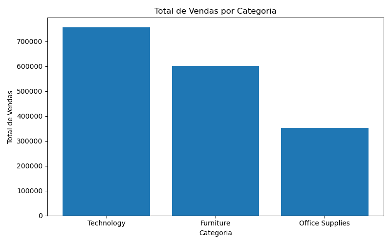
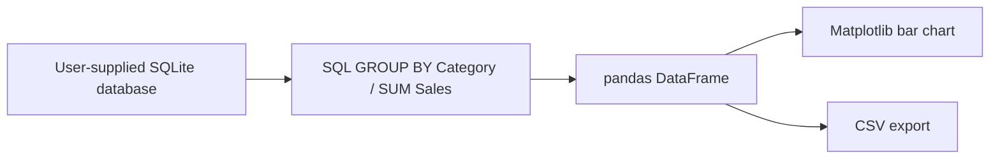

# Sales Analysis with SQL and Python

**SQL aggregation, Python analysis and a category-level sales summary.**

## Problem and approach

This project explores how to turn sales records in SQLite into a concise category-level summary. SQL aggregates sales; pandas loads the result; Matplotlib creates a chart; the script exports a CSV for further analysis.

## Published results — no installation required



The [committed CSV](total_vendas_por_categoria.csv) contains:

| Category | Total sales | Share of the published total |
| --- | ---: | ---: |
| Technology | 756,983.02 | 44.24% |
| Furniture | 601,492.31 | 35.16% |
| Office Supplies | 352,496.14 | 20.60% |
| **Total** | **1,710,971.47** | **100.00%** |

Technology is the largest category in this output. The figures summarize the committed CSV; currency, time period and source-dataset provenance are not documented, so no currency symbol or broader business conclusions are assigned. The source database is not included, and these results have not been regenerated from the original records.

## Workflow and implementation



- `analysis.py`: reads a database in read-only mode, aggregates by category and exports the chart and CSV.
- `queries.sql`: category sales and a separate profit-by-region query. The Python script runs only the category-sales query.
- `total_vendas_por_categoria.csv`: published aggregate output.
- `grafico_vendas_por_categoria.png`: original published chart.

## Run with your own database

Requirements: Python 3.10+ and a SQLite database with a `sales` table containing `Category` (text) and `Sales` (numeric). The optional profit-by-region query additionally needs `Region` and `Profit`.

```bash
python3 -m venv .venv
source .venv/bin/activate
python -m pip install -r requirements.txt
python analysis.py --database /path/to/sales.db --output-dir outputs --no-show
```

Omit `--no-show` to also open the chart interactively. Outputs go to the directory you specify; choosing a directory with existing output filenames replaces those files.

## Limitations

The original database and its provenance are absent. This repository demonstrates the aggregation workflow and publishes an existing summary, but cannot independently reproduce the original totals. There is no forecasting, profitability analysis in the Python script or claimed business impact. Reproduction requires supplying a compatible database.
